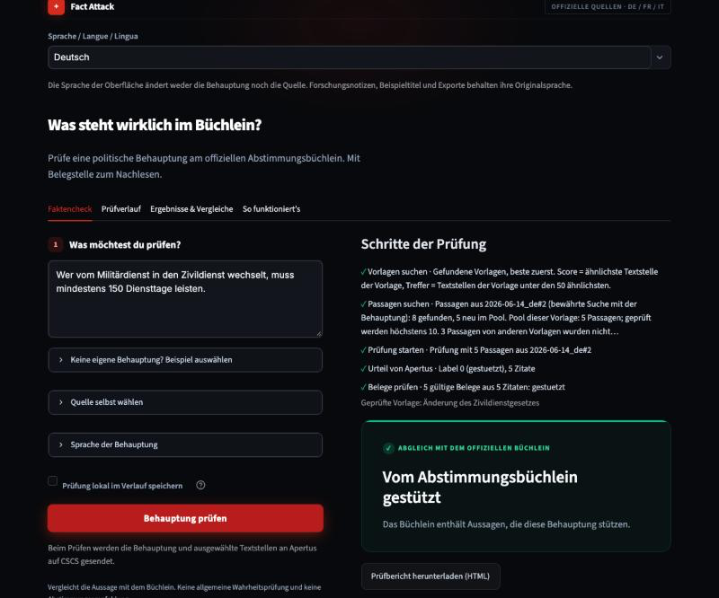
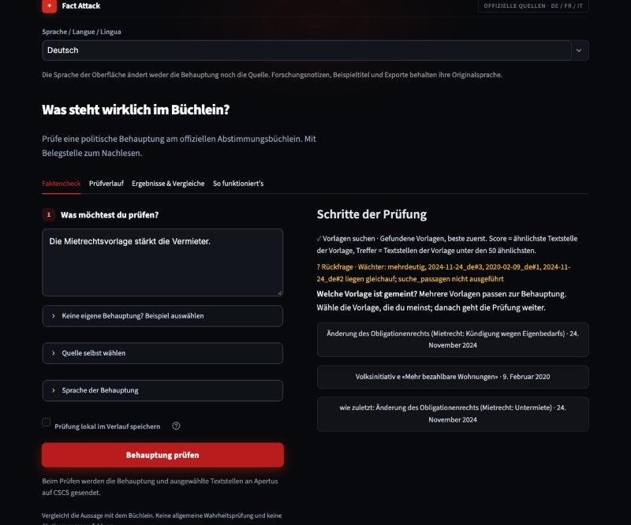

# Agentenschicht, Stufe 4: Rückfrage als Knopf, Live-Schritte, Uploads und „wie zuletzt“

13.11.2026, Branch `genai/agent-stufe4` (von `genai/vector-rag` @ `73a204a`). Aufbau auf [AGENT_STUFE3.md](AGENT_STUFE3.md)
(Wächter, Nachsuche, MCP, gedeckelte Läufe) und dem Plan `docs/superpowers/plans/2026-11-13-agentenschicht-stufe4.md`.
Stufe 4 bringt den Agenten in die Oberfläche: Der Tab „Faktencheck“ prüft über den Agenten, zeigt die Schritte
live, stellt die Rückfrage als Knöpfe im betroffenen Schritt und setzt mit der Antwort **denselben Lauf** fort.

**In dieser Stufe lief keine einzige Apertus-Anfrage.** Alle Tests und die Handprobe laufen mit Mock (kein Netz,
keine Anfragen). Ein echter UI-Lauf mit Apertus wurde nicht gemacht, weil es keine Freigabe von Sheyla mit
Höchstzahl gab (Plan, Task 7, Schritt 5). Wie sich das echte Modell mit der Rückfrage-Fortsetzung verhält, ist
**ungemessen und ungeprüft**; die Handprobe unten zeigt nur, dass die Verdrahtung mit dem Mock-Entscheider
funktioniert. Die Urteile der Mock-Läufe („gestützt“ usw.) kommen vom Mock-Client und sagen nichts über die Qualität.

## Was gebaut ist

| Baustein | Datei | Inhalt |
|---|---|---|
| Interaktiver Graph | `src/agent/graph.py` | `ask` ruft mit Checkpointer `interrupt` auf; `prepare`, `make_checkpointer`, `build_graph(..., checkpointer=)`. Ohne Checkpointer bleibt alles wie in Stufe 3. |
| Feste Vorlage nach der Antwort | `src/agent/tools.py` | `AgentTools.fix_vote`; `_plain` macht gepoolte Passagen zu reinen Python-Werten; `MAX_ID_CHARS` 80. |
| Sitzung | `src/agent/session.py` | `AgentSession` (`start`, `answer`, `pending`, `events`), `Pending`, `Turn`. |
| Live-Hook | `src/agent/trace.py` | `Tracer(on_event=...)`: läuft nach dem Schreiben der Zeile, jedes Ereignis genau einmal. |
| Darstellung | `src/agent_ui.py` | Modul ohne Streamlit: `step_rows`, `outcome_view`, `prediction_for_card`, `vote_for_selection`, `stream`, `options_with_last`. Nur `vote_for_selection` liest eine Datei (die Seitenzahl eines Büchleins, Task 8). |
| Verdrahtung | `src/agent_app.py`, `app.py` | `agent_available`, `get_agent_index`, `make_agent_session(..., session_vote=)`, `AgentCheck`; im Tab die Schrittliste, die Knöpfe, die Ergebniskarte. |
| Uploads und ganzes Büchlein | `src/agent/uploads.py`, `src/agent/search_backend.py` | `upload_vote`, `whole_booklet_vote`, `LocalBackend.add_vote`. |
| Übersetzungen | `src/ui_i18n.py` | 33 neue Zeilen DE/FR/IT (Platzhalter gleich, ein AST-Test prüft jeden Text von `agent_ui.py`). |
| Tests | `tests/test_agent_graph.py`, `test_agent_decider.py`, `test_agent_session.py`, `test_agent_ui.py`, `test_agent_uploads.py`, `test_ui_agent_streamlit.py` | 108 neue Tests (9 davon aus Task 8), siehe Abschnitt Tests. |

B0 ist unverändert: `src/inference.py`, `src/apertus_client.py`, `src/http_chat.py`, die Wettbewerbs-CLI und
`requirements.txt`. Die Schwellen des Wächters bleiben 0.01 / 0.0 / `None`, `TOOL_MODE` bleibt `json`, das gesperrte
Testset wurde nicht berührt.

## Ablauf mit `interrupt` und Fortsetzung

```
START → decide → act ─┬─→ decide
                      ├─→ ask ──── interrupt ────────────────┐   (Lauf pausiert, Pending geht an die UI)
                      │            Antwort (Command(resume))  │
                      │      ┌────────────────────────────────┘
                      │      └─→ decide → act → verify → check_evidence → finish   (Vorlage jetzt fest)
                      ├─→ verify → check_evidence ─┬─→ finish → END
                      │                            └─→ nachsuche → decide → act → verify → check_evidence → finish
                      └─→ finish
```

- **Nur mit Checkpointer.** `build_graph(..., checkpointer=make_checkpointer())` macht `ask` interaktiv. Ohne
  Checkpointer endet der Lauf bei `ask` wie in Stufe 3 mit dem Ergebnis `rueckfrage`; CLI und die Evaluation der
  Stufe 5 messen genau das, und `interrupt` ohne Checkpointer würde werfen.
- **`interrupt` zuerst, Wirkung danach.** LangGraph führt den Knoten nach der Antwort von vorn aus (ein Spike
  zeigte: `ask` lief zweimal). Deshalb steht das Ereignis „Rückfrage beantwortet“ und alles andere mit Wirkung
  **nach** dem `interrupt`; sonst käme es doppelt in die Spur.
- **Antwort prüfen.** Erlaubt sind die Optionen der Frage (und genau eine zusätzliche Vorlage, siehe Memory). Alles
  andere ist ein `ValueError`: in `AgentSession.answer` bleibt die Frage offen, im Knoten (zweite Verteidigung) wird
  daraus ein technischer Fehler.
- **Nach der Antwort.** `tools.fix_vote(id)` macht die Vorlage fest (`suche_vorlagen` und `rueckfrage` verschwinden
  aus den Werkzeugen, der Passagenpool bleibt). Der Systemprompt nennt die feste Vorlage, die Antwort kommt als
  Beobachtung zur unterbrochenen Entscheidung (`decider.observation_messages`), damit keine zwei User-Nachrichten
  hintereinander stehen. Suchschritte und `passage_searches` beginnen neu (die feste Vorlage braucht vor
  `quelle_fehlt` eine Passagensuche in *ihren* Seiten). Pool, Wächter-Cache, Anfrage-Deckel und Tracer laufen
  weiter; `search_steps` und das Rekursionslimit wachsen für den zweiten Suchlauf.
- **Serialisierung.** `make_checkpointer()` baut einen `MemorySaver` mit `JsonPlusSerializer(allowed_msgpack_modules=...)`
  für `VoteRef`, `Observation`, `AgentAction`, `EvidenceItem`, `PredictionResult`, `EvidenceSource`. Ein Test fällt, wenn
  LangGraph „unregistered type“ meldet.
- **`prepare`.** Der Anfang von `run_check` (Länge, Policy, Sprache, Nachrichten) ist herausgezogen. Frühe Ergebnisse
  (nicht deutsche Behauptung ohne Quelle, `legacy`-Policy) kommen als `AgentResult` zurück, ohne Pause.
- **`AgentSession`.** Hält Graph, Checkpointer, `tools`, Entscheider, Engine, Tracer und Anfrage-Deckel über
  Streamlit-Reruns. `start` vergibt eine neue Thread-ID (eine offene Frage der alten gilt nicht mehr), `answer`
  löscht `pending`, **bevor** es fortsetzt (ein zweiter Aufruf ist ein `ValueError` ohne neue Anfrage). Ausnahmen
  außerhalb der Knoten werden wie in `run_check` zu `technischer_fehler` (`graph.crash_result`). `tools`, Engine und
  Tracer müssen von `start` bis `answer` dieselben Instanzen bleiben (Pool und Wächter-Cache liegen nicht im
  Checkpoint); ein beantworteter Lauf lässt die feste Vorlage in den `tools` zurück, deshalb bekommt **jede Prüfung
  neue `AgentTools`**.

## Tracer-Hook, Worker-Thread und Queue

Streamlit zeichnet nur im Skript-Thread; `st.*` aus einem Fremd-Thread bräuchte einen `ScriptRunContext`. Darum:

1. `Tracer(jsonl_path, on_event=...)` ruft `on_event(event)` nach dem Speichern und Schreiben der Zeile auf. Wirft der
   Hook, ist das wie ein Schreibfehler der Spur ein technischer Fehler des Knotens.
2. `agent_ui.stream(call, events)` führt `call` (`session.start` oder `session.answer`) in einem Worker-Thread aus,
   der Hook legt jedes Ereignis in eine `queue.Queue`, und der Skript-Thread liefert die Ereignisse sofort an die
   Schrittliste und zuletzt den `Turn`. Eine Ausnahme von `call` wird im Aufrufer erneut geworfen; ein toter
   Worker wird erkannt, ohne zu hängen.
3. `AgentCheck` (`src/agent_app.py`) ist **eine Prüfung über mehrere Skriptläufe**: Sitzung, Ergebnis des Workers und
   eine `threading.Lock`, die von `start`/`answer` bis zum Ende des Workers gehalten wird. Ein Doppelklick lässt
   Streamlit den ersten Skriptlauf abbrechen, nicht aber seinen Worker. Der nächste Lauf sieht `running`, wartet
   („Die Prüfung läuft noch …“), übernimmt das Ergebnis des Workers und ruft `start`/`answer` **nie ein zweites Mal**
   auf. Jeder `run` bekommt eine frische Queue, damit die Endmarke eines abgebrochenen Laufs keinen späteren beendet.
4. Die laufende Schrittliste ist ein einziges Markdown-Element (wird ganz ersetzt); nur die fertige Liste (mit den
   Knöpfen) ist ein Container. Ein Container, der mehrfach mit weniger Kindern neu gezeichnet wird, behält nämlich
   die überzähligen Kinder der letzten Zeichnung (so blieb „Nächster Schritt läuft …“ stehen).

`step_rows` fasst `decide` und `act` eines Schritts zu einer Zeile zusammen. Eine Wächter-Abfangung **oder** eine
Modell-`rueckfrage` und das zugehörige `ask` ergeben **eine** Zeile (mit `?`), die abgefangene Aktion trägt kein
Häkchen; das erledigt den Hinweis aus AGENT_STUFE3 (zwei `?`-Zeilen). Fehler färben die betroffene Zeile rot
(Budget, Schrittgrenze, Wächter-Suche, Entscheider); ein technischer Fehler ist nie ein Urteil.

## Oberfläche

- Der Faktencheck-Tab läuft über den Agenten, wenn er verfügbar ist: `langgraph` **und** `httpx` importierbar, der
  Indexordner `settings.INDEX_DIR` (`AGENT_INDEX_DIR` oder `.rag-index/agent-sources`) vorhanden und
  `FACT_ATTACK_AGENT` nicht `0`. Sonst bleibt der Tab beim alten Ablauf (`engine.verify_claim`) mit einem kurzen
  übersetzten Hinweis. `app.py` importiert die Agentenschicht lazy, so läuft die App auch mit dem Wettbewerbs-Lock
  (`requirements.txt` hat weder `langgraph` noch `httpx`).
- Links Eingabe und der aufklappbare Bereich „Quelle selbst wählen“ (Häkchen „Diese Quelle für die Prüfung
  vorgeben“); rechts „Schritte der Prüfung“. Die Rückfrage steht **in** der `ask`-Zeile: Frage, ein Knopf je Option
  („Titel · Datum“, das Datum in der UI-Sprache). Ein Klick setzt dieselbe Prüfung fort.
- Ergebnis: ein Urteil (`gestuetzt`, `widersprochen`, `nicht_belegt`) geht in die bestehende Ergebniskarte
  (`prediction_for_card`: Label aus `outcome`, Belege = die geprüften `result.evidence`); die übrigen Ergebnisse
  (`rueckfrage`, `quelle_fehlt`, `technischer_fehler`) zeigt `outcome_view`. Bei einem verworfenen Urteil (kein Zitat
  steht im PDF-Text) zeigt die Karte weder Wahrscheinlichkeitsbalken noch Zahlenabgleich, weil sie dem Label
  `nicht_belegt` widersprächen.
- Behauptung, Quelle oder Sprache ändern: Die Signatur ändert sich, eine offene Frage ist verworfen (kein Resume auf
  den alten Thread). Ein Wechsel der **UI-Sprache** bei offener Frage behält die Prüfung und übersetzt Knöpfe und
  Datum (Titel der Vorlagen und die technische Detailzeile der Schritte bleiben im Original).
- Eine nicht deutsche Behauptung ohne Quelle zeigt „Quelle selbst wählen“ statt eines leeren Bereichs.
- Verlauf: gespeichert werden nur Urteile, nie Fragen oder Zustände. Mehrfachprüfung und Verlauf sind unverändert.

## Memory-Regel „wie zuletzt“

- Gemerkt wird die zuletzt **per Klick** gewählte Vorlage, nur im `st.session_state` (`last_vote_id`), nirgends
  gespeichert. Ohne beantwortete Frage gibt es kein Gedächtnis; eine verworfene offene Frage hinterlässt keins.
  Der Schlüssel wird auch geschrieben, wenn die Prüfung danach als technischer Fehler endet (die Person hat gewählt).
- Bei der nächsten Rückfrage steht die Vorlage als **zusätzlicher Knopf** „wie zuletzt: …“. Steht sie schon unter den
  Optionen, trägt dieser Knopf den Zusatz statt eines Doppels. Es wird nie ohne Klick gewählt und die Vorlage wird
  **nie fest vorgegeben**.
- Für das Modell steht nur ein Hinweis in der User-Nachricht („Zuletzt gewählte Vorlage der Person: «Titel» (id).“).
  `ScriptedDecider` streift diese Zeile ab. Der Wächter fragt trotzdem.
- Antworten erlaubt sind die Optionen plus genau die eine Vorlage, mit der `start` aufgerufen wurde (und die die
  `tools` kennen). Jede andere ID wird abgelehnt, in der Sitzung und im Graphen. Eine letzte Vorlage, die die
  `tools` nicht kennen (zum Beispiel ein früherer Upload), wird still verworfen.
- Wer eine Quelle vorgibt (auch per Upload), bekommt keine Frage und schreibt kein Gedächtnis.

## Uploads

Ein hochgeladenes PDF geht jetzt auch über den Agenten (Stufe 3 hätte es nur im alten Ablauf geprüft).

- `upload_vote(path, language)` macht `custom_<sha256>#0` zur Vorlage der Sitzung: Titel „Eigenes PDF“, alle Seiten,
  Datum leer (die UI zeigt und speichert `None`). Eine leere, passwortgeschützte, beschädigte oder falsch benannte Datei
  ist ein deutscher `ValueError` ohne Pfad und ohne Bibliothekstext; die UI zeigt eine übersetzte Meldung.
- `LocalBackend.add_vote` nimmt nur Ganzbüchlein-Vorlagen (`vote_id == source_id#0`, Seiten nicht leer): eine
  `custom_`-Vorlage (Zeichen `[A-Za-z0-9]` nach dem Präfix) oder, seit Task 8, `<source_id>#0` einer Quelle, die der
  Index kennt (siehe „Ganzes Büchlein“ unten). Pfade wie `../x` oder `x/<bekannte Quelle>`, unbekannte Quellen, Teile
  eines Büchleins (`#1`) und IDs, die der Index schon hat, werden abgelehnt. Die Vorlage liegt im Backend **dieser**
  Sitzung; der geteilte `SourceIndex` wird nie verändert, andere Sitzungen sehen sie nicht.
- Der Upload ist die feste Vorlage der Prüfung: kein Vorlagensuchschritt, keine Frage.
- `LocalBackend.vector_passages` liefert für einen Upload `[]` (kein Index): Die Nachsuche endet mit „Nachsuche ohne
  neue Passagen“ und das erste Ergebnis gilt.
- `MAX_ID_CHARS` stieg von 64 auf 80: `custom_` + 64 Hex-Zeichen + `#0` sind 73 Zeichen, mit 64 wäre jede Upload-ID als
  Werkzeugargument zu lang gewesen (das Schema des MCP-Servers liest dieselbe Konstante).
- Ein gescanntes PDF ohne Textebene wird angenommen und endet als „nicht belegt“ ohne Passagen; es gibt keine OCR-Prüfung.

### Ganzes Büchlein („Quelle selbst wählen“ mit „Automatisch erkennen“, Task 8)

Der echte Index hat `<source_id>#0` nur für Büchlein ohne lesbares Inhaltsverzeichnis, heute für keines. Wählt die
Person ein Büchlein ohne Vorlage, baut `vote_for_selection` darum eine **sitzungslokale Ganzbüchlein-Vorlage**
(`uploads.whole_booklet_vote`): ID `<source_id>#0`, Titel „Gesamtes Büchlein“ (`WHOLE_BOOKLET_TITLE`), Datum und
Sprache aus einer Indexvorlage desselben Büchleins, Seiten = **alle** Seiten des PDFs `booklets_dir/<source_id>.pdf`.
Der Dateiname kommt aus dem Index, nie aus einer Eingabe; die Seitenzahl liest dieselbe Funktion wie beim Upload
(`uploads._all_pages`). Die App reicht die Vorlage wie einen Upload an `make_agent_session(..., session_vote=)`, das
Backend registriert sie über `add_vote`. `engine_vote` macht aus `#0` `None`: Die Engine erkennt die Vorlage im
Büchlein selbst, wie im alten Ablauf. Liefert der Index die Vorlage schon (ein `#0` im Index oder eine gewählte
Vorlage), gilt sie; `add_vote` lehnt eine gleichnamige Sitzungsvorlage ab. Eine gewählte Vorlage, die das Büchlein
nicht hat, bleibt die Meldung „Der Agent kann die gewählte Quelle nicht prüfen“ (kein stiller Rückfall auf das ganze
Büchlein).

## Entscheidungen des Plans

| Frage | Entscheidung | Grund |
|---|---|---|
| Wann `interrupt`? | Nur mit Checkpointer (`build_graph(..., checkpointer=...)`); `run_check` bleibt unverändert | `interrupt` ohne Checkpointer wirft; CLI/Evaluation messen `outcome == "rueckfrage"` |
| Serialisierung | `MemorySaver` mit `JsonPlusSerializer(allowed_msgpack_modules=...)` für die State-Typen | Spike (offline): Rundlauf klappt, LangGraph warnt aber „wird künftig blockiert“ |
| `ask` läuft nach Resume von vorn | Event und Seiteneffekte stehen **nach** `interrupt(...)` | Spike: `ask` lief zweimal; ein Event davor käme doppelt |
| Nach der Antwort | Vorlage wird fest (`AgentTools.fix_vote`), Suchschritte beginnen neu, Pool, Guard-Cache, Budget und Tracer laufen weiter; der Entscheider bekommt die Antwort als Beobachtung, der Systemprompt die Zeile der festen Vorlage | wie Stufe 3 bei der Nachsuche: keine zwei User-Nachrichten hintereinander |
| Live-Schrittliste | Lauf im Worker-Thread, `Tracer.on_event` → `queue.Queue`, Zeichnen nur im Skript-Thread | `st.*` aus Fremd-Threads braucht `ScriptRunContext`; die Queue vermeidet das |
| Werkzeuge in der UI | lokal (`LocalBackend`), ein `SourceIndex` per `st.cache_resource` | der lokale Qdrant-Index erlaubt einen Prozess |
| Ergebniskarte | bestehende Karte, gespeist mit einer `PredictionResult`-Kopie: Label aus `outcome`, Belege = die geprüften `result.evidence` | die Karte liest `label`, `evidence_sources`, `context_pages` |
| Verlauf, Mehrfachprüfung | wie heute; der Verlauf speichert nur Urteile | Spec: bleiben |
| Uploads | `custom_<sha256>#0` als Vorlage der Sitzung; Vektor-Nachsuche liefert für Uploads keine Passagen (kein Index) | Spec: Katalog-IDs oder Upload-IDs, nie freie Pfade |
| Test-/Handprobe-Modus | `FACT_ATTACK_AGENT_MOCK=1`: `ApertusClient(mock=True)` und `ScriptedDecider` | kein Netz, keine Anfragen |

Entscheidungen während der Umsetzung (Rulings des Ablaufprotokolls):

| Frage | Entscheidung | Grund |
|---|---|---|
| Agentenschicht in `app.py` importieren? | Nur lazy; Agentenpfad nur, wenn `langgraph` und `httpx` importierbar, Indexordner vorhanden und `FACT_ATTACK_AGENT != "0"`; sonst der heutige Ablauf | `requirements.txt` (Wettbewerbs-Lock) bleibt unverändert (B0) |
| Bestehende UI-Tests | `isolated_history` in `tests/test_ui_streamlit.py` setzt `FACT_ATTACK_AGENT=0` (einzige Änderung dort) | die alten Tests prüfen weiter den alten Ablauf |
| Wo lebt `make_agent_session`? | In `src/agent_app.py`, nicht in `app.py` | `app.py` läuft bei jedem Rerun neu; AppTest kann dort nichts patchen |
| Engine und Client | je Prüfung eigene (`ClaimVerificationEngine(apertus_client=...)`), nicht `get_engine()` | `install_on_apertus` patcht die Client-Instanz; ein Budget auf der geteilten Engine würde in den alten Ablauf und in die Mehrfachprüfung lecken |
| Doppelklick-Schutz | Sperre in `AgentCheck` statt eines Flags im Session-State | der Worker überlebt den abgebrochenen Skriptlauf; ein Flag würde von dessen `finally` zu früh gelöscht |
| Fehlerbild in Task 2 | `tools._plain`: numpy-Werte der echten Engine (BM25-Score als `numpy.float64`) werden zu Python-Werten | der Checkpointer lehnte sie ab; jeder echte interaktive Lauf endete als technischer Fehler, nur Fakes und die CLI (ohne Checkpointer) sahen es nicht |
| Letzte Vorlage außerhalb der Optionen | zusätzlicher Knopf, Antwort erlaubt (genau diese eine ID) | die Person meint vielleicht dieselbe Vorlage wie zuletzt, auch wenn der Wächter andere nennt |
| Mock-Entscheider nach der Antwort (Task 8) | `ScriptedDecider` liest die gewählte Vorlage aus der Systemnachricht (`prompts.fixed_vote_id_in`, Gegenstück zu `system_prompt(vote)`), nicht aus einem neuen Kanal; eine Passagensuche zählt nur, wenn sie diese Vorlage durchsucht hat | dieselbe Information, die das echte Modell sieht; die Behauptung (User-Nachricht) wird dafür nie gelesen |
| „Automatisch erkennen“ mit gewählter Quelle (Task 8) | sitzungslokale Ganzbüchlein-Vorlage über `add_vote`, siehe „Ganzes Büchlein“ | entspricht der Engine-Erkennung des alten Ablaufs; kein freier Pfad, keine Änderung am geteilten Index |
| Quellenbereich nach „Quelle fehlt“ (Task 8) | nach einem neuen Ergebnis `quelle_fehlt` ein `st.rerun()` | die linke Spalte wird vor dem Ergebnis gezeichnet; ohne Rerun öffnete sich „Quelle selbst wählen“ erst beim nächsten Klick |

## Grenzen

- **Nur lokale Werkzeuge in der UI.** `McpBackend` bleibt der CLI vorbehalten; das `cache_resource`-Muster aus
  AGENT_STUFE3 ist der Weg, falls es nötig wird.
- **Upload und ganzes Büchlein ohne Vektor-Nachsuche** (der Index hat für beide keine Abschnitte); gescannte PDFs ohne
  OCR. Ergebniskarte und Verlauf nennen beim ganzen Büchlein die Vorlage „Gesamtes Büchlein“, nicht die Vorlage, die
  die Engine darin erkannt hat.
- **Die Strategie-Auswahl („Kontext für Apertus“) gilt nur im alten Ablauf und in der Mehrfachprüfung**, nicht im
  Agentenpfad. Mehrfachprüfung und alter Ablauf prüfen Uploads weiter über die Engine.
- **Der Verlauf speichert nur Urteile**, keine Rückfragen und keine technischen Fehler.
- **Eine Antwort legt die Vorlage fest.** Eine zweite Rückfrage im selben Lauf gibt es nicht. Eine Antwort außerhalb
  der Optionen lehnt die Sitzung ab (die Frage bleibt offen); käme sie am Graphen vorbei, wäre es dort ein
  technischer Fehler, der den Lauf beendet (Review-Minor, zurückgestellt, die UI bietet nur die Optionen an).
- **Nur deutsche Behauptungen ohne Quelle** (`LANGUAGES = ("de",)`); FR/IT-Behauptungen brauchen eine gewählte Quelle.
  FR/IT-Büchlein sind nur wählbar, wenn der Agentenindex sie enthält (heute nicht, siehe offene Punkte).
- **Die technische Detailzeile der Schritte** (Werkzeugnamen, Wächtertext, Fehlermeldungen) bleibt deutsch; die UI
  übersetzt Titel, Frage, Knöpfe und Ergebnisse.
- **Pro Prüfung höchstens 12 HTTP-Anfragen** (`MAX_REQUESTS`): Der Deckel gilt für die ganze Prüfung, auch für den
  Teil nach der Antwort. Im Mock gibt es kein Anfrage-Journal.
- **Keine Qualitätsaussage:** Mock-Urteile sind vorgegeben, Einzelläufe sind keine Messung (siehe AGENT_STUFE3).

## Offene Punkte für Stufe 5

Nicht behoben, außer den Punkten 8 und 9 und dem Fehlertext in Punkt 10 (Task 8, jeweils markiert). Die ersten sechs
standen im Ablaufprotokoll als bewusst zurückgestellt und sind hier benannt; die Punkte 1 und 2 zählen, sobald echte
Apertus-Läufe aus der Oberfläche erlaubt sind.

1. **Ein verwaister Worker läuft nach einer Eingabeänderung weiter.** Ändert die Person Behauptung oder Quelle,
   während ein Lauf arbeitet, wird die Prüfung verworfen, der Worker-Thread aber nicht abgebrochen. Er läuft bis zum
   Ende (bis zu `MAX_REQUESTS` echten Anfragen) und sein Ergebnis wird nie gezeigt.
2. **Der geteilte `SourceIndex` wird ohne Sperre aus mehreren Threads benutzt.** Zwei Browser-Sitzungen (oder ein
   verwaister Worker neben einer neuen Prüfung) rufen den lokalen Qdrant-Client gleichzeitig auf; das ist nicht
   ausgeübt und nicht abgesichert.
3. **FR/IT-Büchlein werden angeboten, sind aber als Quelle unbrauchbar.** Die Quellenauswahl zeigt sie (und mit der
   Auswahl „Quelle vorgeben“ ist der Klick möglich), der Agentenindex enthält nur deutsche Büchlein
   (`LANGUAGES = ("de",)`); nach dem Klick erscheint „Der Agent kann die gewählte Quelle nicht prüfen“.
4. **Demo-Beispiele verlieren im Agentenmodus den Fallback auf das gespeicherte Ergebnis.** Ist Apertus nicht
   erreichbar, gibt es nur im alten Ablauf die gekennzeichnete gespeicherte Antwort.
5. **Der AppTest für den Upload schreibt in das echte `data/booklets`.** Der Hilfsaufruf legt `custom_<sha>.pdf` in das
   (von Git ausgeschlossene) Büchleinverzeichnis und löscht es danach; wird der Test hart abgebrochen, bleibt die
   Datei. Abhilfe: `src.config.BOOKLETS_DIR` im Test auf ein Temp-Verzeichnis setzen.
6. **Ein echtes Modell muss eine 73 Zeichen lange Upload-ID abschreiben.** Ein Tippfehler ergibt einen ungültigen
   Schritt, der einen der fünf Suchschritte kostet. Mit fester Vorlage könnte der Graph die ID selbst setzen.
7. **Die alte Hinweiszeile bleibt im Verlauf stehen**, wenn die Antwort eine andere Vorlage als die letzte wählt
   („Zuletzt gewählte Vorlage …“ in der User-Nachricht). Antwort-Prompt und Systemprompt nennen die feste Vorlage;
   ein echter Lauf müsste zeigen, ob das Modell sich davon irritieren lässt.
8. **Behoben in Task 8: Der Mock-Entscheider führte eine beantwortete Frage nicht zu Ende.** `ScriptedDecider` las
   nach der Fortsetzung das alte Ergebnis der Vorlagensuche und suchte in Rang 1 statt in der gewählten Vorlage; die
   Prüfung endete als „Schrittgrenze“. Jetzt liest er die gewählte Vorlage aus dem neuen Systemprompt (siehe
   Entscheidungen). Tests: `test_scripted_decider_uses_the_vote_the_person_chose_after_the_answer`,
   `test_the_scripted_decider_finishes_the_check_with_the_answered_vote` (Sitzung) und der AppTest
   `test_clicking_an_option_in_mock_mode_ends_with_a_verdict_not_a_technical_error` (echte Verdrahtung mit
   `FACT_ATTACK_AGENT_MOCK=1`, nur der Index ist ein Fake, kein Netz). **Weiter offen:** ob der echte JSON-Entscheider
   nach der Antwort richtig weitermacht. Ohne Apertus-Lauf ist nur belegt, was er zu sehen bekommt: Der Test baut die
   Nachrichten wie der `ask`-Knoten; die Systemnachricht nennt „Vorgegebene Quelle: Vorlage <gewählte ID>“, die letzte
   User-Nachricht „Antwort der Person auf die Rückfrage: Gemeint ist die Vorlage <gewählte ID> …“, und
   `suche_vorlagen`/`rueckfrage` werden nicht mehr angeboten.
9. **Behoben in Task 8: „Quelle selbst wählen“ mit „Automatisch erkennen“ war mit dem echten Index unbrauchbar.** Jetzt
   prüft der Agent das ganze Büchlein (siehe Uploads, „Ganzes Büchlein“). Tests:
   `test_add_vote_accepts_a_known_sources_whole_booklet_and_nothing_else`,
   `test_vote_for_selection_returns_a_whole_booklet_vote_for_a_source_without_a_title`,
   `test_a_catalog_vote_is_never_shadowed_by_the_whole_booklet_vote` und der AppTest
   `test_picking_a_source_with_automatic_object_runs_the_agent_with_a_whole_booklet_vote` (echte Verdrahtung, Mock).
   FR/IT-Büchlein bleiben unbrauchbar (Punkt 3): Der Index kennt ihre Quelle nicht, also gibt es auch kein ganzes
   Büchlein.
10. **Kleinere zurückgestellte Befunde der Reviews:** Der Speicher des `MemorySaver` behält verworfene Threads (für eine
    Sitzung unerheblich); `start`/`answer` selbst sind nicht threadsicher (die Sperre sitzt in `AgentCheck`);
    `OUTCOME_LABELS` in `agent_ui.py` doppelt `graph.LABEL_OUTCOMES` ohne Pin-Test; die Hinweiszeile wird im
    `ScriptedDecider` am Präfix abgestreift; `cli_format` zeigt für Uploads ein leeres Datum (die CLI kennt keine
    Uploads). Behoben in Task 8: Der Mock-Entscheider verschachtelt „Das Werkzeug Werkzeugwahl ist fehlgeschlagen“
    nicht mehr (`test_scripted_repeats_its_own_invalid_step_without_nesting_it`); der Bereich „Quelle selbst wählen“
    öffnet sich mit der Bitte um eine Quelle sofort (`test_the_source_expander_opens_with_the_request_to_pick_the_source`).
    Der Katalogtitel „Volksinitiativ e“ (Silbentrennung im Quelltext) bleibt.
11. **Aus Stufe 3 geblieben:** keine „keine“-Schwelle und kein Trefferkriterium (zu wenig Dev-Daten), Behauptungen mit
    ausdrücklichem Vorlagennamen verlieren gegen Embedding-Scores, zusammengesetzte Behauptungen (Safeguarding) und die
    Evaluation B0/B1/B2 gehören in Stufe 5. Ob das Modell mit dem neuen Hinweis (Einschätzung der Behauptung) anders
    antwortet, zeigt erst ein neuer echter Lauf.

## Starten und testen

Voraussetzung: die Umgebung aus [UI_UND_PYTHON312.md](UI_UND_PYTHON312.md) (der Lock enthält `langgraph`, `httpx` und
den MCP-Teil) und der Agentenindex (`AGENT_INDEX_DIR`, sonst `.rag-index/agent-sources`).

Mit Mock, ohne Netz und ohne Anfrage (so lief die Handprobe):

```sh
cd track_2a
FACT_ATTACK_AGENT_MOCK=1 HF_HOME=/Users/sheyla/Documents/ChatGPT/GenAI/work/model-cache HF_HUB_OFFLINE=1 \
  ../.venv312/bin/streamlit run app.py --server.port 8599 --server.headless true
```

Mit echtem Apertus (nicht in dieser Stufe gelaufen; jede Prüfung zählt gegen `MAX_REQUESTS = 12`):

```sh
cd track_2a
FACT_ATTACK_ENV_FILE=<Pfad zur eigenen .env> HF_HOME=... HF_HUB_OFFLINE=1 \
  ../.venv312/bin/streamlit run app.py --server.port 8501
```

| Umgebungsvariable | Wirkung |
|---|---|
| `FACT_ATTACK_AGENT=0` | Der Tab bleibt beim alten Ablauf (so laufen die alten UI-Tests). |
| `FACT_ATTACK_AGENT_MOCK=1` | Mock-Client und `ScriptedDecider`, keine Anfrage verlässt den Rechner, kein Anfrage-Journal. |
| `AGENT_TRACE_DIR` | Ordner der Spuren (`<Lauf>.trace.jsonl`, echt auch `<Lauf>.requests.jsonl`); Standard `.agent-traces`. |
| `AGENT_INDEX_DIR` | Ordner des Agentenindex; fehlt er, ist der Agentenpfad nicht verfügbar. |

Ohne `FACT_ATTACK_AGENT_MOCK` und ohne Schlüssel soll die UI die übersetzte Meldung „Die Prüfung konnte nicht
abgeschlossen werden“ zeigen (so beschreibt es der Bericht zu Task 4; in der Handprobe nicht ausprobiert, weil dafür
nichts gesendet werden durfte). Spuren der Handprobe lagen unter einem Temp-Ordner, nicht im Repo.

Tests (die Suite bleibt ohne Netz; die AppTests sperren `_request_completion`):

```sh
cd track_2a
HF_HOME=/Users/sheyla/Documents/ChatGPT/GenAI/work/model-cache HF_HUB_OFFLINE=1 ../.venv312/bin/python -m pytest -q
```

## Was die Handprobe abdeckte

13.11.2026, Streamlit mit `FACT_ATTACK_AGENT_MOCK=1` auf Port 8599, gesteuert im eingebauten Browser, Server danach
beendet. Keine Apertus-Anfrage, der Verlauf war abgeschaltet (Häkchen entfernt), das Test-PDF wurde danach gelöscht.

| Fall | Ergebnis |
|---|---|
| Eindeutige Behauptung (Zivildienst, 150 Diensttage) | Schrittliste füllt sich, fünf Zeilen mit Häkchen, Karte „Vom Abstimmungsbüchlein gestützt“ (Mock-Urteil). |
| Mehrdeutige Behauptung („Die Mietrechtsvorlage stärkt die Vermieter.“) | Eine `?`-Zeile des Wächters, die Frage und drei Knöpfe in der Zeile, keine zweite `?`-Zeile. |
| Klick auf eine Option | Die Prüfung lief im selben Lauf weiter, **endete aber im Mock als roter technischer Fehler** („Schrittgrenze“, kein Urteil, kein Verlaufseintrag): offener Punkt 8, in Task 8 behoben und nachgeprüft (unten). |
| Zweite Rückfrage nach einer beantworteten | Zusätzlich der Knopf „wie zuletzt: …“ (die Vorlage des ersten Klicks), nichts vorausgewählt. |
| Sprachwechsel DE → FR bei offener Frage | Frage, Knöpfe („comme la dernière fois : …“), Datum („24 novembre 2024“) und Überschriften übersetzt, die Frage blieb offen. Die Detailzeile der `?`-Zeile blieb deutsch (Grenze). |
| Quelle ändern bei offener Frage | Die Frage verschwindet, der rechte Bereich zeigt wieder den leeren Platz. |
| „Quelle selbst wählen“, Datum 14. Juni 2026, Vorlage „Änderung des Zivildienstgesetzes“ | Keine Frage; Passagensuche in der festen Vorlage, erste Prüfung, Nachsuche, zweite Prüfung, Karte mit Beleg. |
| „Quelle selbst wählen“ mit „Automatische Erkennung“ | „Der Agent kann die gewählte Quelle nicht prüfen“, kein Lauf: offener Punkt 9, in Task 8 behoben und nachgeprüft (unten). |
| Upload eines einseitigen Test-PDFs (selbst erzeugt, 1 kB) | Wird angenommen (die UI stand damals auf Französisch: „Source active : PDF personnel“), keine Frage, vier Schritte, Karte; die Vorlage heißt `custom_<sha256>#0`, die lange ID steht in den Schritten. |
| Französische Behauptung ohne Quelle | „Quelle selbst wählen“ im rechten Bereich statt leerem Platz. |





**Nicht geprüft** (nur in den AppTests oder gar nicht): Doppelklick auf einen Knopf, Budget erschöpft oder Apertus-Ausfall
nach der Antwort im Browser, ein echtes Modell, zwei gleichzeitige Browser-Sitzungen, Italienisch, Mobilansicht,
Mehrfachprüfung und Verlauf im Browser, Speichern in den Verlauf (war abgeschaltet), gescannte PDFs, eine
französische Behauptung mit gewählter Quelle, ein Rückfall bei fehlendem Agentenindex. Beim Test blieb der Bereich
„Quelle selbst wählen“ nach der Bitte um eine Quelle zugeklappt (in Task 8 untersucht und behoben, unten).

### Nachprobe nach Task 8

13.11.2026, gleicher Aufbau (Mock, Port 8597, eingebauter Browser, Verlauf abgeschaltet, Server danach beendet, keine
Apertus-Anfrage, kein Upload):

| Fall | Ergebnis |
|---|---|
| „Die Mietrechtsvorlage stärkt die Vermieter.“, Klick auf die dritte Option (2024-11-24_de#2, Untermiete; Rang 1 wäre #3) | Passagensuche in #2, Prüfung, Nachsuche (Vektor) in #2, zweite Prüfung, Karte „Im Abstimmungsbüchlein nicht geklärt“ (Mock-Urteil), „Geprüfte Vorlage: … (Mietrecht: Untermiete)“. Kein roter Schritt. |
| „Quelle selbst wählen“, 14. Juni 2026, DE, „Automatisch erkennen“, Zivildienst-Behauptung | Keine Frage; Passagensuche in `2026-06-14_de#0`, Prüfung, Karte „Vom Abstimmungsbüchlein gestützt“ mit Beleg auf Seite 26 und vier weiteren, „Geprüfte Vorlage: Gesamtes Büchlein“. |
| Französische Behauptung ohne Quelle | Die Bitte „Quelle selbst wählen“ rechts, der Bereich „Quelle selbst wählen“ links ist im selben Klick offen (vorher erst nach einem weiteren Rerun, im Browser nachgestellt). |

Nicht nachgeprüft: die übrigen Fälle der Handprobe oben (die AppTests decken sie weiter ab), eine andere Sprache des
Büchleins mit „Automatisch erkennen“, ein echtes Modell.

## Tests

Vollständige Suite auf dem Stand dieser Stufe: **967 Tests bestanden**, 196 Subtests, 8 bekannte Warnungen (fünf
PDF-Deprecation-Warnungen und drei Warnungen des Fork-Pools; Stand vor Stufe 4: 859 bestanden, 108 neue Tests, davon 9
aus Task 8; vor Task 8: 958). Die
AppTests laufen mit `default_timeout=50` und sperren jede echte HTTP-Anfrage. Nach der Suite blieb kein Server-Prozess
zurück.
