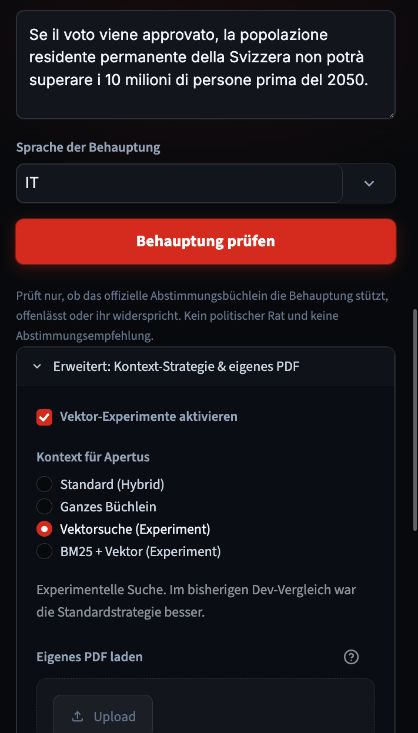
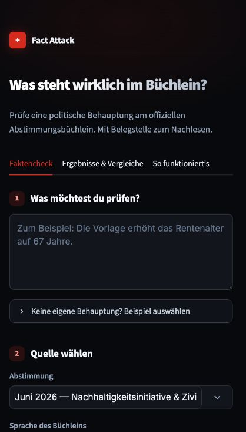
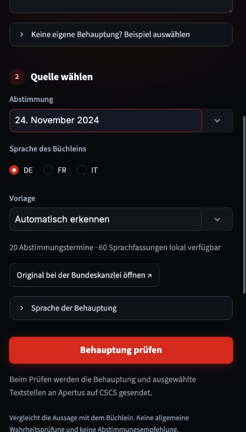
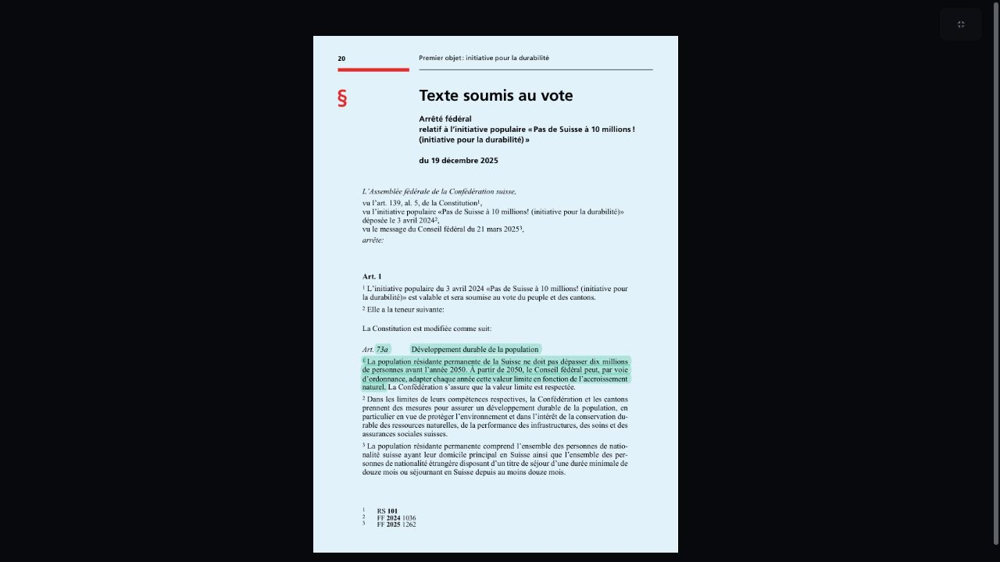
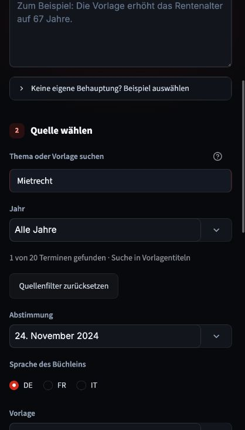
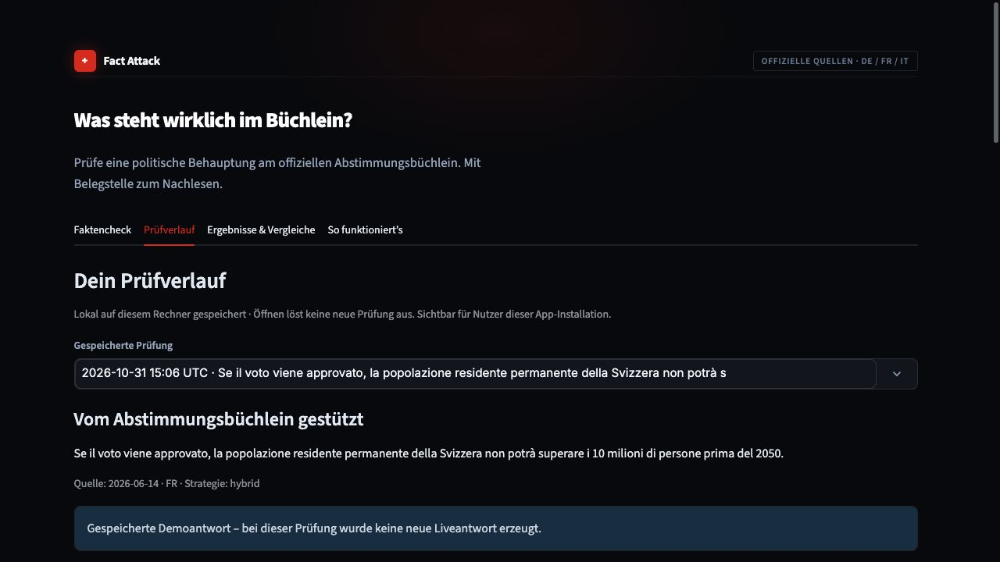
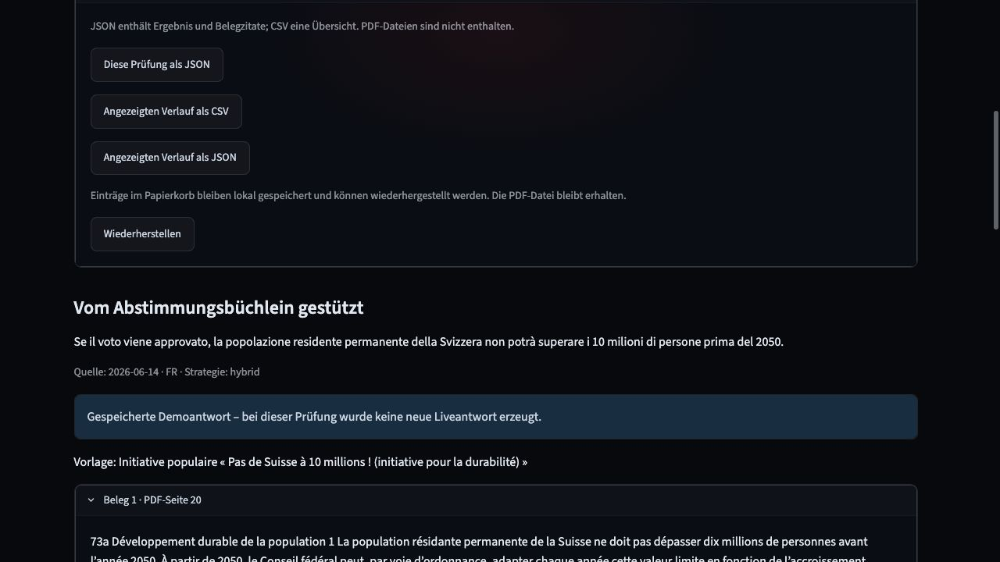

# Streamlit-Integration und geprüfte Python-3.12-Umgebung

Stand: 31.10.2026. Der Standard bleibt `hybrid`. Die letzten realen Dev42-
Ergebnisse sind unverändert (kein erneuter 42-Fälle-Modelllauf unter dem neuen Backend): [ERGEBNISSE_NLI42.md](ERGEBNISSE_NLI42.md).
In dieser Integrationsphase gab es **null neue NLI-API-Anfragen**.

## Was jetzt funktioniert

Im Faktencheck unter **Erweitert → Vektor-Experimente aktivieren** erscheinen
`Vektorsuche (Experiment)` und `BM25 + Vektor (Experiment)`. Ohne Opt-in stehen
Standard-Hybrid und Volltext bereit. Opt-out setzt eine gewählte Vektoroption
zurück auf Hybrid. Ein Wechsel der Strategie macht ein altes Ergebnis ungültig;
Hybrid-Demoergebnisse werden nicht als Vektorergebnisse wiederverwendet.

Die Optionen sind als Experimente gekennzeichnet; die UI behauptet keinen Vorteil
gegenüber Hybrid. Fehlende lokale RAG-Abhängigkeiten werden als lokaler Fehler
angezeigt. Der Live-Benchmark bietet vorerst keine Vektormodi an, damit keine
zweite langlebige Qdrant-Engine parallel denselben persistenten Index öffnet.
Der Benchmark zeigt den vollständigen echten 42-Fälle-Vergleich mit F1, Evidence
Hit@5 und Prompttokens getrennt von historischen Konfigurationen. Unvollständige
oder Mock-Reports werden dort nicht als 42-Fälle-Ergebnis angezeigt.
Die Benchmark-Erklärung bezeichnet die bisherigen Splits korrekt als beobachtete
Dev-/Regressionsdaten statt als nie verwendeten Test.



Die Oberfläche läuft lokal unter [127.0.0.1:8501](http://127.0.0.1:8501).
Starten, Beispielauswahl oder Umschalten der Optionen löst keine NLI-Anfrage aus.
Nur der Prüfen-Button startet eine Liveprüfung; die vorhandene
CSCS-Konfiguration ist in der laufenden lokalen Vorschau geladen.

## Zugang ohne kopierte `.env`

`FACT_ATTACK_ENV_FILE` verweist explizit auf eine vorhandene Konfigurationsdatei.
Für diese Maschine ist das
`/Users/sheyla/Projects/Apertus-Team-Fact-Attack-2026/track_2a/.env`.
Werte werden beim Prozessstart geladen, keine Schlüsseldatei in den Worktree kopiert.
Eine fehlende explizite Datei erzeugt einen Fehler; sie aktiviert keinen stillen
Mock. Bereits gesetzte Laufzeit-Proxy-/API-Variablen haben weiterhin Vorrang.
Andere Teammitglieder verwenden den Pfad zu ihrer eigenen lokalen Konfiguration.

## Ressourcen und Quellen

Eine UI-Engine hält höchstens drei offene Vektorindizes, mit LRU-Verdrängung und
explizitem Schliessen. Identische Absatzinhalte unter verschiedenen Dateipfaden
teilen denselben Index. Zugriff, Verdrängung und Schliessen sind durch denselben
Lock geschützt. Streamlit ruft beim Cache-Freigeben `engine.close()` auf;
eine freigegebene Engine darf keine neuen Vektorclients erzeugen. Eine sofortige
Freigabe bei Prozessabbruch wird vom Streamlit-Hook nicht garantiert.

Ein persistentes `RAG_INDEX_DIR` gehört weiterhin einem Prozess; mehrere Streamlit-
Worker oder gleichzeitig gestartete CLI-Prozesse brauchen getrennte Verzeichnisse.
Die experimentellen Vektorsuchen innerhalb einer Engine sind serialisiert, nicht
parallel beschleunigt. Der globale Parsercache des Bestands ist kein LRU-Cache.

Uploads haben eine inhaltsbasierte Dateikennung. Gleicher Dateiname mit neuen
Bytes kann daher keine alten Parserdaten oder Ergebnis-Signaturen übernehmen.
Speichern erfolgt atomisch über eine temporäre Datei; beschädigte Zwischenstände
werden beim erneuten Speichern repariert. Uploads bleiben lokal im Büchleinordner,
werden aber von Git und beiden Docker-Buildkontexten ausgeschlossen. Beim Prüfen
gehen ausgewählte Textstellen wie bisher an Apertus; das ist am Upload erläutert.

Der PDF-Cache berücksichtigt zusätzlich Parser-/Quellcode, Python- und Backend-
Versionen. Der E5-Index berücksichtigt nun auch Torch-, Transformers- und Tokenizer-
Versionen. Dadurch werden z. B. Extraktions-/Embeddingcaches aus der früheren
abweichenden Python-3.10-Umgebung nicht still als Ergebnisse der neuen Umgebung
verwendet. E5 ist standardmässig auf die getestete Revision
`614241f622f53c4eeff9890bdc4f31cfecc418b3` gepinnt.

## Originalbelege im vorhandenen Passage-ID-Pfad

Sechs Integrationsfälle prüfen beide Vektormodi für die Labels 0/1/2 mit absichtlich
übersetzten Modellzitaten, veränderten Arbeitspassagen und doppelten IDs auf einer
Seite. Unter `raw_pages_and_blocks` stammen ausgegebene Belege vollständig aus der
zugeordneten physischen Original-PDF-Seite in Lesereihenfolge. Neutral exportiert
keine Belege. Dies bestätigt den bereits vorhandenen Produktionspfad; es ist keine
neue Qualitätsmessung auf den 42 Fällen und kein neues Evidence-Hit@5-Ergebnis.

Zusätzlich lief unter der neu aus dem Lockfile installierten Umgebung ein echter
lokaler E5-/Qdrant-Funktionstest für `vector` und `vector_hybrid`, mit explizit
injizierter NLI-Ausgabe. Originalbelege und anschliessend geschlossene Indizes wurden
geprüft. Report: `track_2a/results/genai/python312_ids_smoke.json`.

## Reproduktion auf macOS ARM64

CPython **3.12.13**, unveränderte `requirements.txt` plus `requirements-rag.txt`.
Alle **89** installierten Distributionen sind im vollständigen Hash-Lock
`track_2a/requirements-genai312-macos-arm64.lock.txt` fixiert. Das Lock wurde an den
getesteten Versionsstand gebunden. Die Installation in eine zweite, leere Umgebung
mit `--require-hashes` war erfolgreich; alle installierten Versionen wurden danach
gegen das Lock geprüft. Für die erstmalige Hash-Prüfung waren nicht alle Wheel-
Archive im lokalen Cache, daher war die Paketinstallation nicht vollständig offline.

Aus dem Repo-Root:

```sh
uv python install 3.12.13
uv venv --python 3.12.13 .venv312
uv pip install --python .venv312/bin/python --require-hashes \
  -r track_2a/requirements-genai312-macos-arm64.lock.txt
.venv312/bin/python -m pytest track_2a/tests -q
```

Lokale Oberfläche mit der vorhandenen Konfiguration:

```sh
FACT_ATTACK_ENV_FILE=/Users/sheyla/Projects/Apertus-Team-Fact-Attack-2026/track_2a/.env \
HF_HOME=/Users/sheyla/Documents/ChatGPT/GenAI/work/model-cache HF_HUB_OFFLINE=1 \
.venv312/bin/python -m streamlit run track_2a/app.py \
  --server.address 127.0.0.1 --server.port 8501 --browser.gatherUsageStats false
```

`HF_HUB_OFFLINE=1` setzt bereits vorhandene Modellgewichte voraus. Auf einer neuen
Maschine zuerst die gepinnte öffentliche E5-Revision herunterladen. Bei der ersten
Vektorprüfung ohne vorbereiteten Modellcache ist ein Download nötig. Ein separates
Indexverzeichnis kann mit `RAG_INDEX_DIR` angegeben werden.

Reiner Integrationstest ohne echte NLI:

```sh
HF_HOME=/Users/sheyla/Documents/ChatGPT/GenAI/work/model-cache HF_HUB_OFFLINE=1 \
.venv312/bin/python track_2a/scripts/smoke_python312_ids.py
```

## Tatsächliche Prüfung und offene Punkte

- **241 Tests plus 6 Subtests bestanden** in der zweiten Lock-Umgebung.
- Reale Streamlit-AppTests: Opt-in, Strategiewechsel, Reset, fehlende Extras,
  kein Hybrid-Fallback und Cache-Freigabe. HTTP-Kompletierungen sind darin gesperrt.
- Sichtprüfung im lokalen Browser: Optionen und Hinweistexte passen; keine
  Liveprüfung ausgelöst. Lokale Vorschau ist mit vorhandener Konfiguration bereit.
- Paket-, Modell- und Quellcodeinformationen stehen in `python312_environment.json`
  und `python312_ids_smoke.json` unter `track_2a/results/genai/`.
- Acht Warnungen im abschliessenden Gesamtlauf: fünf PDF-Deprecation-Warnungen und drei Warnungen des
  bestehenden Fork-Pools beim Ausführen von Tests in einem mehrthreadigen Prozess.

**Docker-Reproduktion bleibt offen.** Der Docker-Client ist installiert, der
Docker-Desktop-Daemon war nicht gestartet. Ein erfolgreicher Containerbuild oder
Linux-RAG-Lock wird deshalb nicht behauptet. Das Mac-Lock ist kein CPU-Linux-
Containerlock; das bestehende Containerimage nutzt zudem Python 3.12.6.
Die Dockerfiles wurden hier nicht um ein RAG-Profil erweitert. Die neuen Ignore-
Regeln halten lokale Indizes, Annotationen, Umgebungen und private Uploads aus
beiden Buildkontexten. Vor einer separaten Dashboard-Containerprüfung sind auch
die benötigten UI-Demodateien zu prüfen: die bisherigen Dockerfiles kopieren nur
`demo_cases.jsonl`, während das UI `demo_cases.json` und `demo_votes.json` liest.
Die Demo-JSON enthält Goldlabels und darf daher nicht unbereinigt in ein Abgabe-
Image kopiert werden.


## Vereinfachter Faktencheck-Ablauf (31. Oktober 2026)

Die Oberfläche beginnt mit einer leeren Behauptung und führt danach zur Quelle.
Beispiele sind optional eingeklappt und füllen nur Behauptung und offizielle Quelle
vor. Bei der Beispielauswahl wird ein zuvor ausgewähltes eigenes PDF abgewählt.
Ein leerer Text deaktiviert den Prüfbutton; nur ein bewusster Klick startet die NLI.
Die Sprache wird automatisch erkannt, mit manueller Auswahl unter einem Expander.

Die Ergebnisansicht zeigt zuerst die Einordnung und danach die Belegstellen.
Labelnummern, Tokens, Laufzeit und Konfidenzen stehen unter „Details zur Prüfung“.
„Nicht geklärt“ beschreibt den geprüften Kontext und behauptet keine vollständige
Abwesenheit einer Aussage im Dokument. Die Navigation lautet „Faktencheck“,
„Ergebnisse & Vergleiche“ und „So funktioniert’s“. Der Footer verlinkt den aktuellen
Entwicklungsbranch und das Originalprojekt getrennt.

Validierung: acht gezielte Streamlit-/Strategietests bestanden, einschliesslich
Beispielauswahl ohne Inferenz, deaktiviertem Leertext-Button und gespeicherter
Ergebnisansicht bei blockiertem Live-Aufruf. Keine echte NLI-Anfrage in dieser
UI-Überarbeitung. Mobile Sichtprüfung im lokalen Browser.




## Erweiterter offizieller Quellenkatalog

Der feste Demo-Katalog wurde durch `data/booklet_catalog.json` ersetzt. Er enthält
60 offizielle PDF-URLs für 20 Abstimmungstermine vom 9. Februar 2020 bis zum
14. Juni 2026, jeweils DE/FR/IT. Die Metadaten stammen aus den Spalten Datum,
Büchlein-URL und Vorlage des OST-Datensatzes; für diese Erweiterung wurden keine
Behauptungen oder Gold-Labels ausgewertet. Das ist kein vollständiges Schweizer
Abstimmungsarchiv und erweitert nicht den gemessenen 42-Fälle-NLI-Vergleich.

Alle 60 Dateien wurden lokal von `www.bk.admin.ch` geladen (zusammen rund 76 MB),
mit pypdf geöffnet und mit Seitenzahl und SHA-256 in
`results/genai/booklet_inventory.json` protokolliert. Zusätzliche heruntergeladene
PDFs bleiben wie bisher ausserhalb von Git. Nach einem frischen Checkout:

```sh
cd track_2a
python -m src.booklet_catalog
```

Die UI selbst startet keine Downloads. Sie bietet nur Katalogeinträge mit lokalem
PDF-Header an, filtert Sprachen je Datum und setzt eine ungültig gewordene
Vorlagenauswahl zurück. Eigene Uploads gelangen nicht in den offiziellen Katalog.
Nicht verfügbare Demo-Beispiele werden ausgeblendet. Jeder offizielle Eintrag
hat einen direkten Originallink zur Bundeskanzlei. Vorlagentitel stammen aus den
bestehenden Demo-Metadaten bzw. ansonsten aus dem OST-Katalog und können dessen
Textartefakte enthalten.

Elf gezielte Katalog-/UI-Tests bestanden, auch mit nur einer installierten Sprachfassung. Im Browser wurden die 20 Termine und
der Wechsel auf das nachgeladene November-2024-Büchlein geprüft. Keine neuen
NLI-Anfragen. Beide Dockerfiles kopieren nun auch die Katalog-Metadaten; ein
Containerbuild bleibt weiterhin ungeprüft.




## Originalseite mit Belegmarkierung

Unter jeder unterstützten Belegseite lässt sich „Originalseite … öffnen“
aufklappen. PyMuPDF rendert die physische Originalseite als PNG mit einer nur im
Arbeitsspeicher ergänzten Markierung. Die PDF-Datei wird nicht überschrieben.
Der angezeigte Belegauszug (ohne künstliches abschliessendes Auslassungszeichen)
wird vollständig gesucht; kurze Präfixe werden nicht als Ersatz markiert.
Nach Whitespace-/Trennstrichnormalisierung muss der Auszug genau einmal auf der
Seite vorkommen und die PDF-Suche passende Koordinaten liefern. Andernfalls
erscheint die Originalseite unmarkiert mit einem ausdrücklichen Hinweis.
Neutrale Ergebnisse erhalten keine Belegmarkierung.

Die bestehende Auswahl des angezeigten Belegauszugs auf der zitierten Seite und
die NLI-/Exportlogik bleiben bestehen. Eine Markierung ist eine Lesehilfe, keine
zusätzliche fachliche Verifikation. Die Beschriftung nennt die physische
PDF-Seitennummer, die von der gedruckten Seitenzahl abweichen kann. Vollbild,
Lesetext und Download des unveränderten Original-PDFs stehen bereit.
Vorschaubilder werden begrenzt im Streamlit-Arbeitsspeicher gecacht (12 Einträge),
ohne Dateipersistenz oder externe Übertragung. Auch der Lesetext markiert keine
kurzen Präfixe mehr als Ersatz für ein nicht gefundenes vollständiges Zitat.

Zwölf gezielte PDF-/UI-Tests bestanden (fünf bestehende PDF-Deprecation-Warnungen).
Validiert mit synthetischen eindeutigen, fehlenden, wiederholten und neutralen
Zitaten, ungültiger Seitennummer und dem echten italienischen PDF auf Seite 22.
Die UI-Sichtprüfung lief in einer separaten lokalen Instanz mit blockierter API
und einer ausdrücklich als gespeichert gekennzeichneten Demoantwort. Das echte
französische Original auf Seite 20 und seine Markierung wurden im Vollbild
geprüft. Keine neuen NLI-Aufrufe und keine neuen Modell-Qualitätsmessungen.




## Quellen nach Thema und Jahr finden

Die Quellenauswahl lässt sich lokal nach Vorlagentiteln und Jahr filtern.
Suchbegriffe werden ohne Gross-/Kleinschreibung oder Akzentunterschiede mit den
DE-/FR-/IT-Titeln sowie dem Datum verglichen; mehrere Begriffe müssen alle
vorkommen. Das ist eine Titelsuche, keine PDF-Volltext- oder semantische Suche.
Ein Treffer in einer Sprache erhält alle verfügbaren Sprachfassungen des Termins.
Die Prüfung bleibt auf genau das gewählte Büchlein und die gewählte Vorlage bezogen.

Bei null Treffern wird die vorherige offizielle Quelle sichtbar beibehalten,
die Datumsauswahl gesperrt und eine Prüfung mit ihr deaktiviert. Die Filter
lassen sich mit einem Klick zurücksetzen. Ein eigenes hochgeladenes PDF bleibt
unabhängig von den Filtern nutzbar. Demo-Beispiele setzen die Quellenfilter zurück,
damit ihre zugehörige Quelle auswählbar bleibt. Ein durch Filter geändertes
Büchlein invalidiert wie bisher die Signatur eines alten Ergebnisses.

Neun gezielte Katalog-/Streamlit-Tests bestanden (fünf bestehende PDF-Warnungen),
inklusive sprachübergreifender Suche, Jahr, Nulltreffern, Reset und Beispielwechsel.
Der Filtertest verwendet Katalogmetadaten und benötigt keine nachgeladenen PDFs.
Im Browser führte „Mietrecht“ zu genau einem Termin, dem 24. November 2024.
Keine Downloads oder Apertus-Aufrufe durch die Suche.




## Lokaler Prüfverlauf

„Prüfung lokal im Verlauf speichern“ ist beim Start aktiviert und kann vor einer
Prüfung abgewählt werden. Erfolgreiche Prüfungen werden mit UTC-Zeitpunkt,
Behauptung, Vorlage, Strategie, Ergebnis, Belegen und SHA-256 der Quelle in
`track_2a/data/.local-history/checks.sqlite3` gespeichert. Die ursprünglichen
PDF-Dateien werden dafür nicht kopiert. Jede bewusst gestartete erfolgreiche
Prüfung legt einen eigenen Eintrag an; ein reines Öffnen des Verlaufs nicht.
Demo-Fallbacks sind als `saved_demo` statt als neue Liveantwort gekennzeichnet.
Eine fehlgeschlagene Verlaufsspeicherung verwirft nicht das angezeigte Ergebnis.

Im Tab „Prüfverlauf“ lassen sich frühere Antworten und Belege nach einem App-
Neustart ohne neue Inferenz ansehen. Eine Originalvorschau wird nur gezeigt,
wenn die gespeicherte PDF-Datei noch denselben Inhalts-Hash hat; sonst bleiben
Zitate und Ergebnis als historische Momentaufnahme lesbar. Die Auswertung wird
nicht neu berechnet oder als aktuell verifiziert ausgegeben.

SQLite schreibt Einträge transaktional; neu angelegte Datenbankdateien erhalten
Modus 0600. Verlauf und Nebenfiles sind aus Git und beiden Docker-Buildkontexten
ausgeschlossen. Das ist ein lokaler Verlauf für diese App-Installation, kein
persönliches Konto oder Mehrbenutzersystem: Nutzer derselben Installation sehen
denselben Verlauf. Export und ein wiederherstellbarer Papierkorb sind ergänzt (siehe unten).
Eine endgültige Löschung oder automatische Aufbewahrungsfrist ist nicht implementiert.

Neun gezielte Speicher-/Streamlit-Tests bestanden (fünf bestehende PDF-Warnungen):
Persistenz über einen neuen App-Lauf, Abschalten der Speicherung, Demo-/Live-
Kennzeichnung, veränderte oder fehlende Quellen und Pfadbegrenzung. UI-Tests
verwenden ausschliesslich temporäre Datenbanken. Die Browser-Sichtprüfung nutzte
eine separate Datenbank unter `/tmp` mit blockierter API und einer gespeicherten
Demoantwort. Keine neue Apertus-Anfrage. Die normale lokale Vorschau enthält
keinen dadurch angelegten Demo-Verlaufseintrag.




## Verlauf exportieren und Einträge entfernen

Im Tab „Prüfverlauf“ trennt „Ansicht“ aktive Einträge und Papierkorb.
Unter „Export & Verlauf verwalten“ stehen der einzelne Eintrag als JSON und der
angezeigte Verlauf als JSON bzw. CSV bereit. JSON enthält Belegzitate, Kennzeichnung
der Antwortherkunft und die Quellenidentität, aber keine internen absoluten Pfade,
Retrieval-Debugmetadaten oder PDFs. CSV ist eine UTF-8-Übersicht mit BOM für Excel;
formelähnliche Zellinhalte werden mit einem Apostroph entschärft. Die Downloads
werden lokal erzeugt und nicht an einen weiteren Dienst übertragen.

„In Papierkorb verschieben“ blendet nur den ausgewählten Eintrag aus der aktiven
Liste aus. „Wiederherstellen“ im Papierkorb holt ihn zurück. Es werden keine
Datenbankzeilen oder PDF-Dateien endgültig gelöscht. Der Papierkorb ist keine
Datenschutzlöschung und bleibt wie der aktive Verlauf lokal gespeichert.
Bestehende SQLite-Datenbanken werden bei der ersten Änderung um eine Spalte
`removed` ergänzt; alte Einträge bleiben aktiv. Neue Prüfungen lassen sich danach
weiter speichern. Exportiert wird die jeweils angezeigte Ansicht, aktive Einträge
oder Papierkorb. Ein JSON-Import ist noch nicht vorgesehen.

Zwölf gezielte Speicher-/Streamlit-Tests bestanden (fünf bestehende PDF-Warnungen),
inklusive alter Datenbank, neuer Einträge nach Migration, Papierkorb, Rückkehr,
Neustart und Exportinhalt/CSV-Sicherheit. Die Browserprüfung verwendete nur die
isolierte Demo-Datenbank mit blockierter API: entfernt und erfolgreich
wiederhergestellt. Keine neuen Apertus-Aufrufe.


